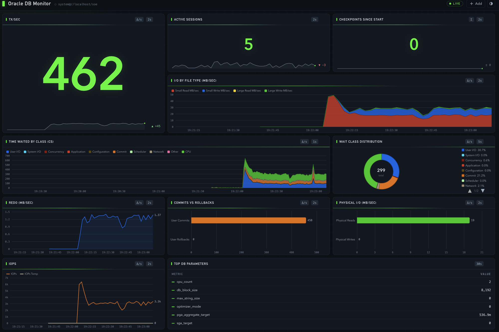

# Data Monitor

Data Monitor is a simple dashboard for Oracle Database. You lay out a grid of panels (I call them QModules), each one runs a SQL query every few seconds and shows the result as a chart, a table or a single big number. It runs as a desktop app, in a browser or in a terminal.



## Requirements

* Java 17 or later
* An Oracle Database (any edition, I've tested it against 19c and 23ai)
* For Autonomous Database you'll need the wallet

## Installation

Download the zip from the [Releases](https://github.com/domgiles/DataMonitor/releases) page. The release marked **Latest** is the current stable version. There's also a **Latest build** pre-release, which is rebuilt every time the code changes, if you want the newest features and don't mind the odd rough edge.

Unzip it and you'll get this:

```
DataMonitor/
├── bin/
│   ├── datamonitor          desktop version (macOS/Linux)
│   ├── datamonitorweb       web version (macOS/Linux)
│   └── datamonitor.yaml     the config file
├── winbin/
│   ├── datamonitor.bat      desktop version (Windows)
│   └── datamonitorweb.bat   web version (Windows)
├── lib/
│   ├── datamonitor.jar      the app and all of its libraries
│   └── launcher/            used by the launcher, leave alone
└── launcher/                Apache Commons Launcher (JVM settings are in launcher.xml)
```

The scripts in `bin` should already be executable. If they aren't

```sh
chmod +x bin/datamonitor bin/datamonitorweb
```

## Configuration

Everything is in `bin/datamonitor.yaml`.

### Connection

```yaml
settings:
  connection:
    username: system
    password: welcome1                   # encrypted the first time the file is loaded
    connectString: //localhost/XEPDB1    # TNS alias or //host:port/service
    # credentialsFile: /path/to/wallet   # ADB only
```

Passwords aren't left in clear text. If you type one into the file, Data Monitor encrypts it the next time it starts, so `password: welcome1` becomes something like `password: enc(iy8gA6J1mqsFX7Dc...)`. Nothing else in the file is touched, comments included. Passwords entered in the editors are saved encrypted as well. Older configs that use `enc:<base64>` still work and get upgraded in the same way.

If you'd rather not type the password into the file at all, run

```sh
./bin/datamonitor --encrypt
```

It asks for the password twice (without echoing it) and prints the `enc(...)` value for you to paste in.

The key used for the encryption is built into Data Monitor, which means you can copy a config to another machine and it'll still work. The flip side is that anyone with a copy of Data Monitor could decrypt it. It stops passwords being visible on a screen share or in a config you send to someone, but if that's not enough, keep the file readable only by you or leave the password out and use `-p`.

### Dashboard settings

| Key | Default | What it does |
|---|---|---|
| `title` | `Data Monitor` | Window title |
| `theme` | `dark` | `dark` or `light` |
| `refreshRate` | `5` | How often queries run, in seconds. Can be overridden per QModule |
| `windowSize` | `120` | Seconds of history shown on LINE and AREA charts |
| `columns` | `3` | Number of grid columns (1 to 3) |
| `border` | `8` | Gap between panels, in pixels |
| `flashOnChange` | `true` | Flash TEXT panels when their value changes |

### QModules

Each entry under `qmodules:` is one panel.

```yaml
qmodules:
  - title: "Active Sessions"
    grid: "R1,C2"          # where it goes
    chartType: TEXT        # TEXT | LINE | AREA | BAR | PIE | TABLE
    processingMode: NONE   # NONE | DIFFERENCE | CHANGE_PER_MIN | CHANGE_PER_HOUR | CUMULATIVE_SINCE_START
    refreshRate: 2         # seconds, overrides the global setting
    windowSize: 120        # seconds of history (LINE/AREA only)
    divideBy: 1048576      # optional, every value is divided by this
    sql: |
      SELECT 'Active Sessions', count(*)
      FROM v$session
      WHERE status = 'ACTIVE' AND type = 'USER'
```

#### Grid

| Format | Example | Meaning |
|---|---|---|
| `R<r>,C<c>` | `R1,C2` | Row 1, column 2 |
| `R<r>,C<a-b>` | `R2,C1-2` | Row 2, across columns 1 and 2 |
| `R<r>,C<c>*` | `R1,C1*` | Row 1, across every column |
| `R<a-b>,C...` | `R3-4,C1-2` | Rows 3 and 4, columns 1 and 2 (a 2x2 block) |

A row range works with any of the column forms. A panel that covers more than one row is as tall as those rows plus the gaps between them.

#### Chart types

* `TEXT` a single value shown large, with a small trend line underneath
* `LINE` one or more series over time
* `AREA` filled series over time
* `BAR` a bar per row, redrawn each refresh
* `PIE` shares of a total
* `TABLE` label/value rows

#### Processing modes

* `NONE` shows the value the query returns
* `DIFFERENCE` shows the change per second between runs
* `CHANGE_PER_MIN` shows the change per minute
* `CHANGE_PER_HOUR` shows the change per hour
* `CUMULATIVE_SINCE_START` shows how much the value has grown since the dashboard started

The three rate modes show 0 on the first run, otherwise you'd get a spike every time you start the dashboard. If a counter goes backwards (say after an instance restart) they show 0 rather than a negative number.

`CUMULATIVE_SINCE_START` is handy for counters that move so slowly a rate would sit at 0 most of the time.

#### What the SQL should return

Each row is one series (or one bar, slice, etc.). Return either two columns

```sql
SELECT 'label', value FROM ...
```

or three, with a colour in the middle

```sql
SELECT 'label', 'colour', value FROM ...
```

To return several series from one query use `UNION ALL`

```sql
SELECT 'Reads',  'green', sum(phyrds)  FROM v$filestat UNION ALL
SELECT 'Writes', 'red',   sum(phywrts) FROM v$filestat
```

Colours can be names like `red`, `blue`, `green`, `orange`, `yellow`, `cyan`, `pink`, `light green`, `light gray`, `dark red`, `gray brown` and so on.

### Editing the dashboard while it's running

You don't need to edit the YAML by hand to change the layout.

* Right click a panel and pick **Edit...** or **Delete...** (it asks before deleting)
* To add one, use the **+** button in the header or right click an empty bit of the dashboard and pick **Add QModule...**

The Add/Edit dialogue has three parts.

* **Module** for the title, chart type, processing mode, refresh rate, window size and divide by. Tick **Default** to use the dashboard wide value. A panel can also have its own database connection.
* **Location** shows a small version of the dashboard. Grey cells are used by other panels and green ones are free. Click a cell, or drag out a rectangle to cover several rows and columns. There's always a spare row at the bottom so you can drag onto new rows.
* **SQL** is where the query goes. Press **Validate SQL** (or Cmd/Ctrl+Enter) to run it once and see what comes back. You can't save until the query validates. Only `SELECT` and `WITH` statements are allowed, so validating can't change any data.

Changes are written to the config file as soon as you make them. The first time this happens your original file is copied to `datamonitor.yaml.bak`, which is worth keeping because the saved file loses any comments.

## Running

macOS/Linux

```sh
./bin/datamonitor
```

Windows

```bat
winbin\datamonitor.bat
```

The scripts run from the `bin` directory and pick up `bin/datamonitor.yaml`. To use a different config pass `-c`. A relative path is read from `bin`, so it's simplest to give the full path

```sh
./bin/datamonitor -c /path/to/other.yaml
```

The scripts use Apache Commons Launcher, so JVM settings like the heap size (`-Xmx512m`) are in `launcher/launcher.xml`. You can also run the jar directly

```sh
java -jar lib/datamonitor.jar -c bin/datamonitor.yaml
```

Other options are `--theme dark|light` to override the theme, `--version` and `-h` for help.

### Web version

```sh
./bin/datamonitorweb                  # http://127.0.0.1:8080
./bin/datamonitorweb --port 9090
winbin\datamonitorweb.bat             # Windows
```

`datamonitorweb` is just `datamonitor --web`. From a source checkout you can use `ant run-web` (or `ant run-web -Dargs="--port 9090"`).

When it starts it checks it can connect to the database and then prints a link like

```
http://127.0.0.1:8080/?token=Xy3...
```

Open that in your browser. The token is a random key generated each time the server starts, and nothing works without it, so use the new link after every restart.

It shows the same panels and themes as the desktop version, plus

* tooltips on bar and pie charts as well as line and area charts
* a **Show as table** option for any panel
* add, edit and delete from the right click menu, the **...** menu on each panel, **+ Add** in the header, or by clicking an empty space in the grid
* changes made in one browser show up in any other browser that has it open

Edits are saved to the config file in the same way as the desktop version.

| Option | Meaning |
|---|---|
| `--web` | Run the web version instead of the desktop app |
| `--port <n>` | Port to listen on (default `8080`) |
| `--bind <address>` | Address to listen on. The default `127.0.0.1` only allows connections from this machine, `0.0.0.0` allows anyone |

A word of warning. Anyone with the link can see the dashboard, change the panels and run `SELECT` statements as the dashboard's database user. Unless you really need remote access leave `--bind` as it is. It's plain HTTP, so if you do open it up put it behind an HTTPS proxy or use an SSH tunnel. Passwords are never sent to the browser.

### Terminal version

If you're on a server over SSH, or just prefer a terminal, the dashboard can be drawn with characters instead, a bit like btop.

```sh
./bin/datamonitor --cl
winbin\datamonitor.bat --cl         # Windows, best in Windows Terminal
```

It uses the same config file and the same grid as the other versions, and takes the same options (`-c`, `--theme`, `-u`, `-p` and so on).

At the moment it shows

* TEXT panels as big digits, with a small trend line and the change since the last reading
* BAR panels as horizontal bars
* TABLE panels as tables

LINE and AREA panels show their latest values for now; the charts themselves are coming. PIE panels list each value with its share of the total.

Keys

* `q` or Esc to quit
* `p` or space to pause the display (the queries keep running)
* `t` to swap between the dark and light colours. It doesn't change the terminal's background, so pick whichever reads best
* ↑ ↓ (or PgUp/PgDn) to scroll when the terminal is too short to show every row

It's view only. To add or change panels use the desktop or web version, or edit the YAML. Anything that would normally be logged while it's running goes to `datamonitor-cl.log` in your temp directory instead, so it doesn't mess up the screen.

It needs a real terminal, so it can't be run with its output redirected. A terminal at least 80x24 works, but bigger is better. Most modern terminals (iTerm2, Windows Terminal, the macOS Terminal, GNOME Terminal, PuTTY) are fine.

### Connection details on the command line

You can pass the username, password and connect string on the command line instead of (or as well as) putting them in the config file.

```sh
./bin/datamonitor -u system -p welcome1 --connect-string //dbhost:1521/orclpdb
./bin/datamonitor -p "$DB_PASSWORD"      # username and connect string come from the YAML
```

| Option | Replaces |
|---|---|
| `-u`, `--username <user>` | `settings.connection.username` |
| `-p`, `--password <password>` | `settings.connection.password` (clear text or `enc(...)`) |
| `--connect-string <connect>` | `settings.connection.connectString` |

You can use any of them on their own. They only apply to that run and are never written to the config file, even if you edit the dashboard. If you give all three you don't need a `connection` section in the YAML at all. Panels with their own `connection:` aren't affected.

Bear in mind that a password on the command line can be seen by other users with `ps` and will probably end up in your shell history. Using an environment variable like the second example keeps it out of the history, but not out of `ps`.
